# Python spawner review, 15 November 2026

Live walk of the control page at v0.10, commit 2469802. Server was `py cli.py --serve` on http://127.0.0.1:8765. Default preset. Seeds 31, 13, and 42.

The spawner works. All three seeds produced a deterministic map: section roads, rivers, rail, farmsteads with house plans, and small rail towns. The first view of a new seed is the part that feels broken. The page sits on "Generating visible chunks..." over a blank map, with no count of what is left. Seed 42's first files arrived after about seven minutes. Seed 13 did the same. After that 32-mile river basin is cached, panning and zooming inside it is immediate, and a new detail chunk in the same area finished within about half a minute.

Buttons I used: the seed box, pan, zoom, and Find a town on seed 31. I did not click Random, Lock, the presets, or Save and Load JSON. Those controls are on the page.

## Interface

At 1280 pixels the header wraps. West sits on the first row. North, South, East, and the zoom buttons sit on the second. The version is printed twice, once in the header and once at the top of the settings column. Every generation stage starts open. Each control repeats its name above a collapsed "About this setting," so the column is a long scroll beside a square map.

There are no town names on the map. Previous town and Next town stay disabled until Find a town is used, including while a town is already on screen. Find a town widens the view from 12 miles to 96 miles until it sees a town rectangle. That search pays for new basins when the nearest accepted town is far away.

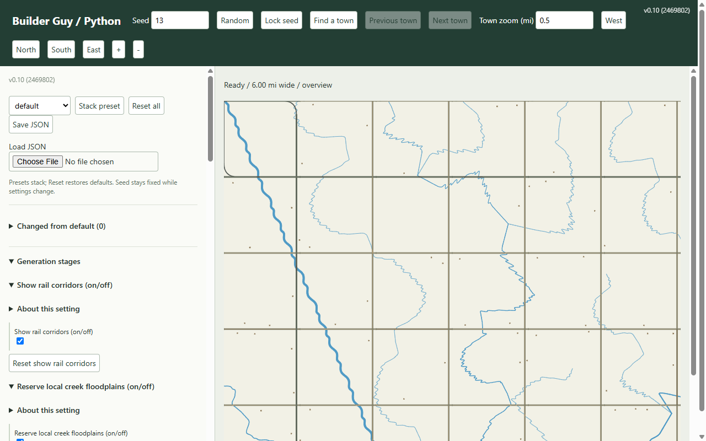

## Towns

Both towns that were opened are the same kind of place. A few blocks hang off a section road. They are not a main street. Streets are drawn as the full right-of-way, about 66 feet, so the dark fills swallow the lots. Houses sit on the edges of the blocks. Room lines show up when you are close. Block interiors are empty. There are no trees in the plat.

Seed 31, one pan north of the origin, then Find a town at the default 0.5 mile zoom. One short house row on a long empty street. The rail is a hairline. The depot is a speck. Closer in, the houses are pale stamps with room lines, and the south row is gappy.

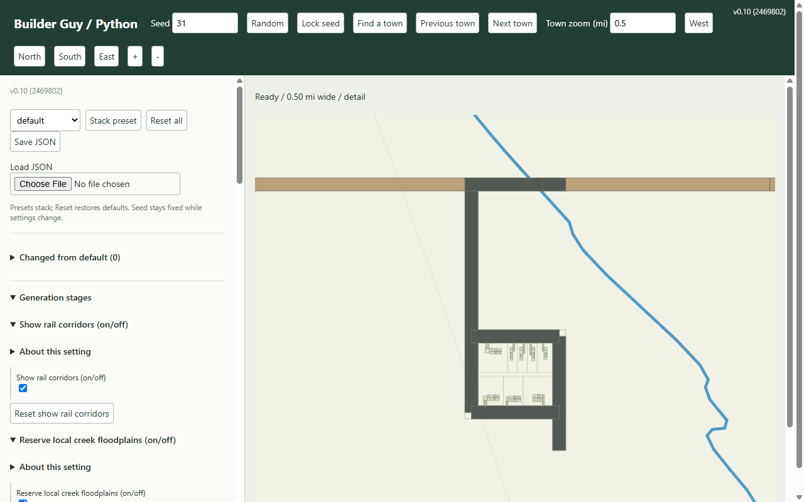

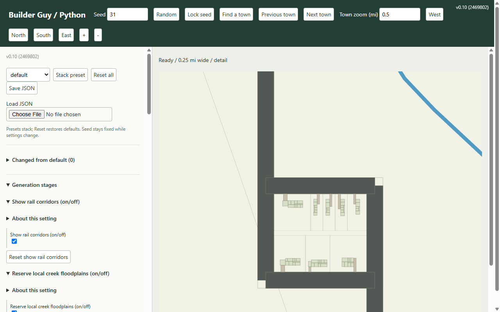

East of that block, the elevator is an empty 400-foot square in the field, with a second blank industry rectangle beside it. Three blue strands run side by side across the tan road, and there is no clear bridge deck.

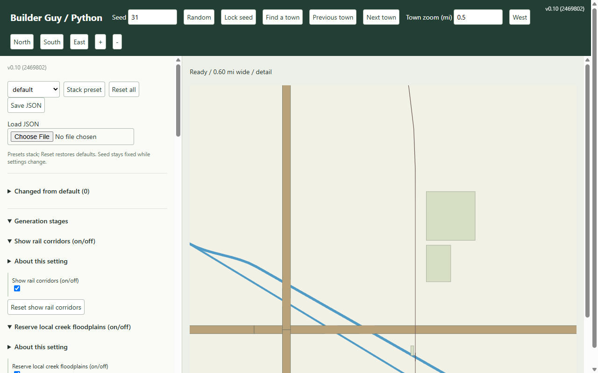

Seed 42's accepted town is `town:rail:h:0:0`, about a mile north of the origin. The nearest vertical rail station, about a mile south, did not grow a town. It is a section-road cross with a hairline and a farmyard. The town that did grow has two blocks, a tan section road, and a rail that bends through the plat. Up close the rail is a wide dark band and reads as another street. Previous and Next were still disabled, because the view was moved by hand and Find a town had not been pressed.

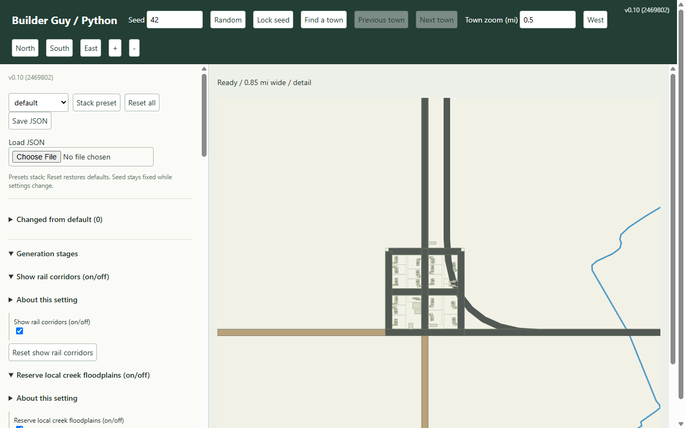

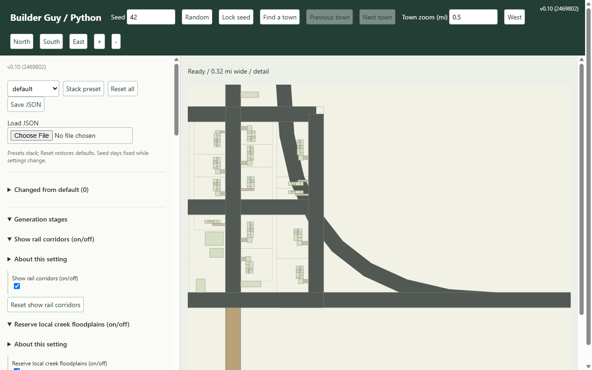

Seed 13's origin has no town in the generated ring, about 12 miles across. The nearest rail-station candidate is about 18 miles out. The nearby corridor is one of the unused ones. `world.rail_enabled_pct` defaults to 70. A gap that large is allowed. Accepted towns are 6 to 10 miles apart, and a floodplain or a failed elevator can leave a bigger hole. The page should say that, instead of searching outward in silence.

## Countryside

At 6 to 10 miles the mile grid is what reads. Corners jog and round off at the 24-mile survey corrections, and some section lines stop. Farmsteads are sparse dots. One trunk river meanders cleanly. Many tributaries are angular. Some end inside a section. Some fan into several strands.

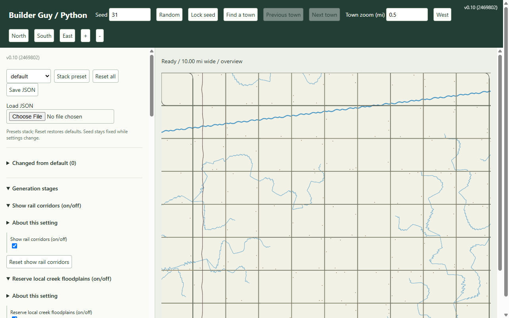

Close in, a yard is a lot outline, a driveway to the section road, and a house plan. Some yards add a grain bin, a quonset, a poultry house, and a dotted windbreak. Buildings stay small pale stamps until the view is well under half a mile. The section road itself is a wide filled band. Gravel reads tan. Some section roads read dark.

Seed 31, three yards on a vertical gravel road. Tree dots along one lot line. A single river bend in the corner. Most of the frame is empty field.

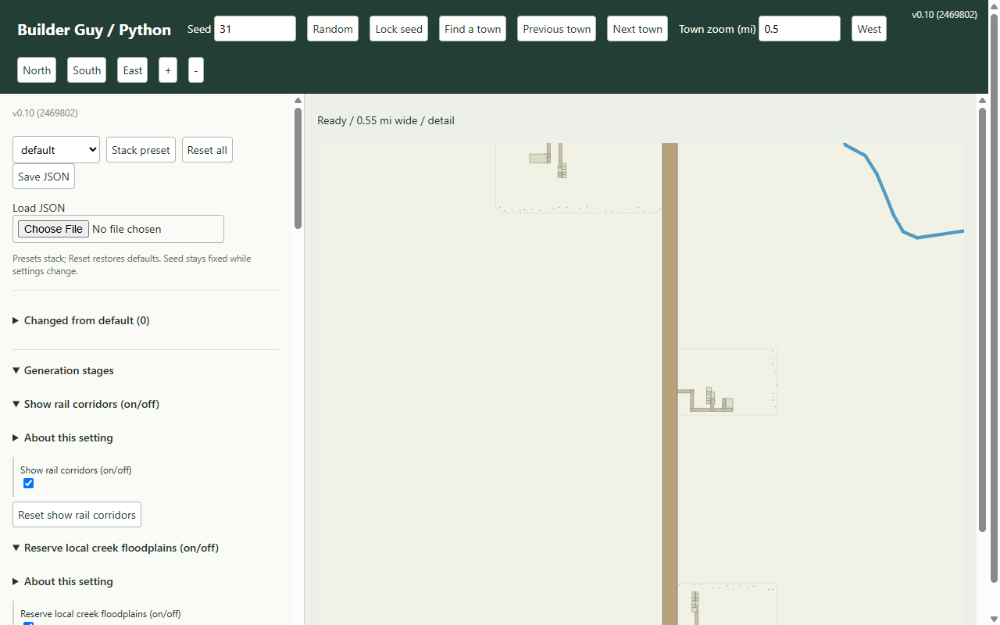

Seed 13, one yard at 0.56 miles. The house plan is there, kitchen through bedrooms, and the lane zigzags out to the road. This particular yard has no outbuildings and no trees. On the right, several blue strands fan into the road with no bridge deck.

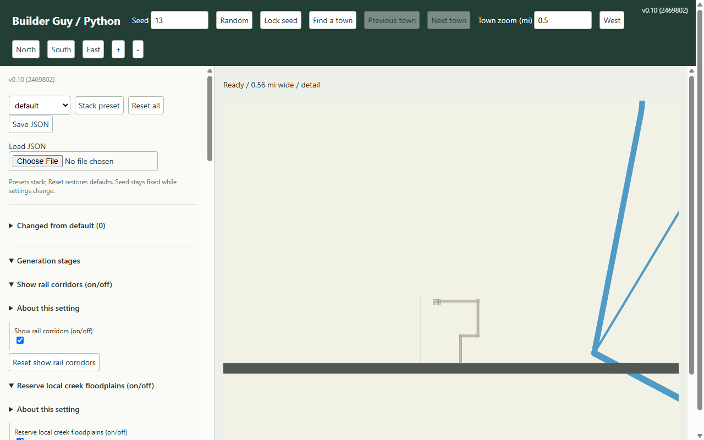

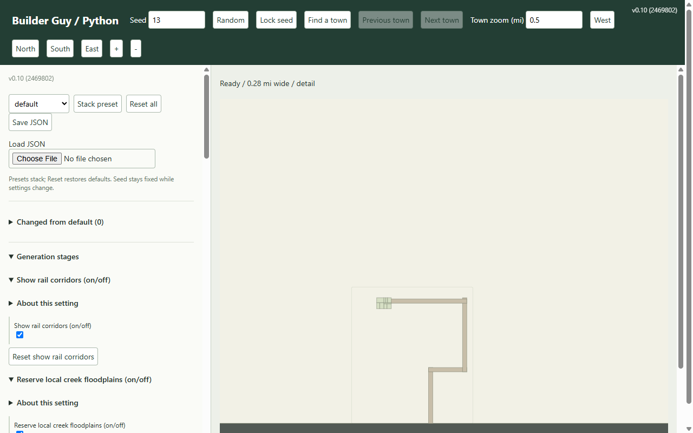

Seed 42 at the rejected vertical station. Tan section cross, a hairline that is probably the unused-looking rail, one small yard, and a single clean river bend. This is the countryside when the station candidate does not become a town.

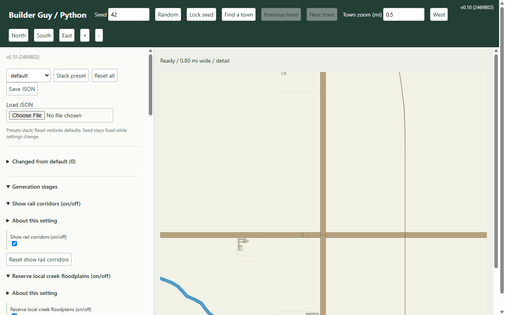

## Improvements

The generator is producing the right pieces. The picture still reads as a survey diagram. Do these in this order. The first two change every screenshot above.

**Draw the traveled surface, not the right-of-way.** Town streets and section roads are filled at the full right-of-way, about 66 feet. At a third of a mile that band is wider than the houses and eats the lots. Draw the 22-foot surface. Keep the right-of-way as a thin line, or leave it out. The same change fixes the dark bars in the countryside.

**Make rail and water look unlike roads.** Up close the rail is the same dark fill as a street and bends through the plat with no ties. Far away it is a hairline. Give it a narrower stroke, a distinct color, and a tie or dash pattern that still shows on the overview. Rivers need one strand per channel. Seed 31 drew three parallel strands across the road at the elevator. Seed 13 fanned several strands into one crossing. A crossing should show a bridge deck.

Leave the Part 5 spacing numbers alone. That work was stopped on purpose, and the cold audit is deferred. The duplicate strands are a separate drawing bug.

**Put a town on the map as a town.** Fill the street frontage. Plant trees on the lots. Draw the elevator and the depot as buildings with a spur, not a blank 400-foot square and a speck. At 6 to 10 miles a tenth-of-a-mile plat disappears. Drop a marker and a name on the overview. Turn Previous and Next on as soon as a town is in a loaded chunk. Find a town should jump to the nearest accepted station instead of widening from 12 miles to 96 and paying for new basins. Seed 13's empty origin is allowed. Say how far the next town is.

**Show the first basin while it computes.** A new seed is a blank page for several minutes because one worker builds the first 32-mile basin before any SVG is written, and the status line has no count. Report the basin and the chunk, and paint each finished chunk as it lands. After the basin is cached the same view is immediate, so the wait is the cold start, not the drawing.

**Quiet the page.** Collapse the generation stages. Stop repeating each control's name above "About this setting." Print the version once. Keep the header on one row so West is not stranded above North. Give the map the width the open settings column is using.

## Left alone on purpose

Part 5 river spacing. The user stopped it. Do not retune those numbers from this review.

Town spacing. Candidate rail stations are 6 to 10 miles apart. Floodplains, junction competition, and a missing elevator can omit a station. Do not treat a larger gap between accepted towns as a broken promise.
